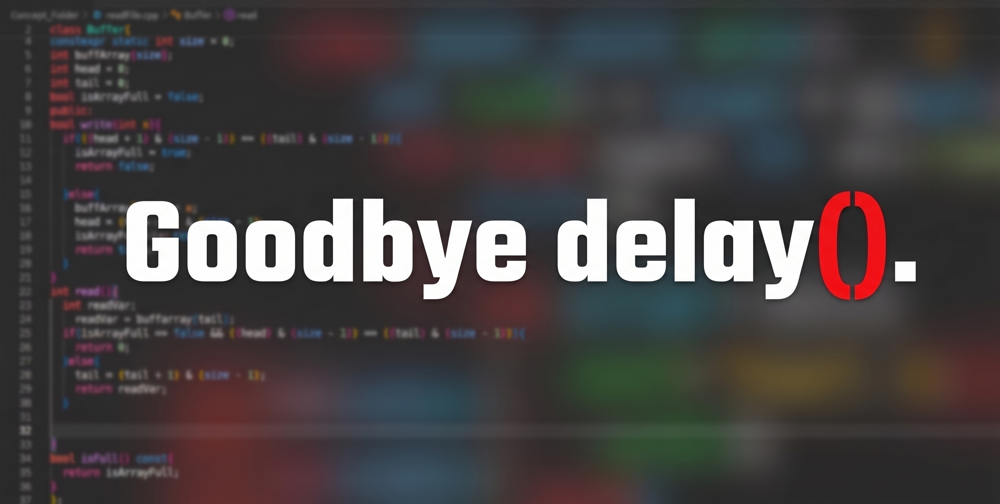
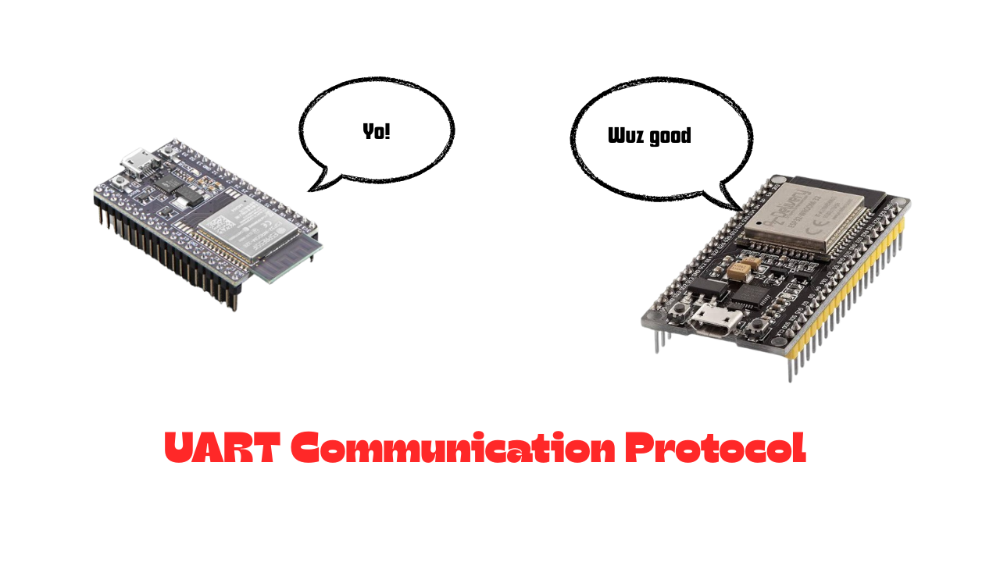
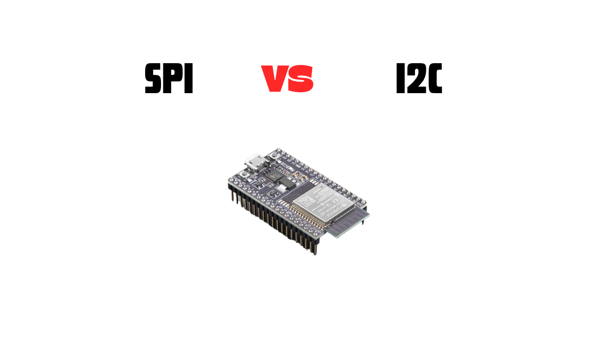
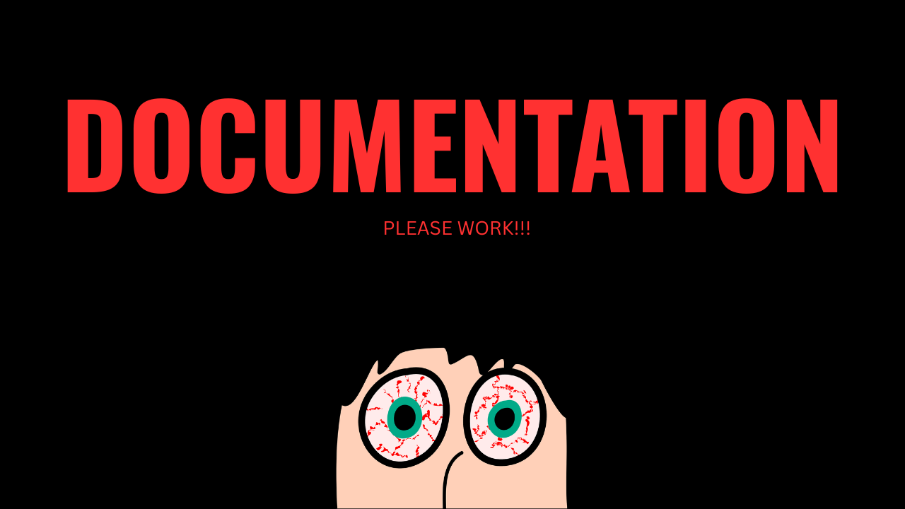
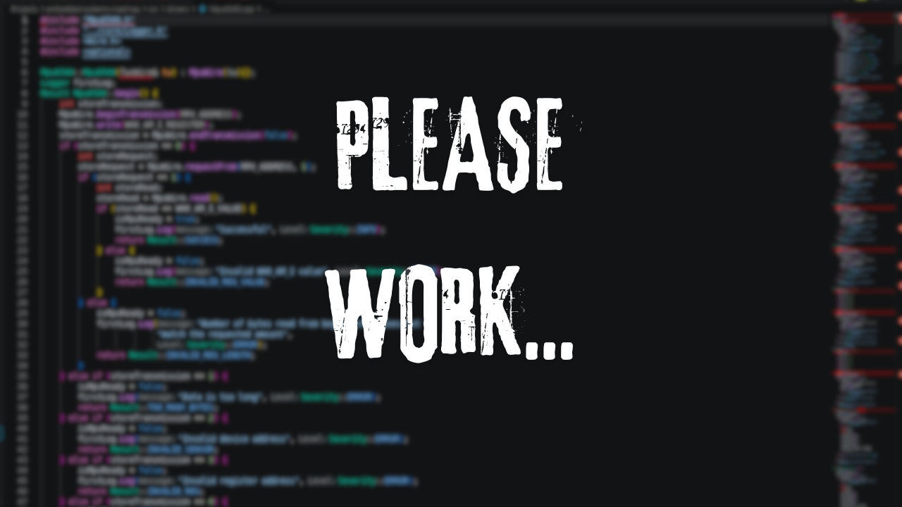

# Embedded Systems Roadmap

## Goal

Become employable as a Junior Embedded/Firmware Engineer by building one production-quality firmware project.

---

## About This Repository

This repository documents my journey into professional embedded systems and firmware development.

Rather than building multiple unrelated projects, I am developing one firmware project that evolves throughout the roadmap—from simple embedded C++ foundations to a complete Industrial IoT node using ESP32, FreeRTOS and ESP-IDF.

Every milestone builds upon the previous one.

---

## Technologies

- Modern C++
- ESP32
- Arduino IDE (Temporary)
- FreeRTOS
- ESP-IDF
- Git
- GitHub
- I²C
- SPI
- UART
- MQTT
- OTA Updates

---

## Roadmap

- [ ] Milestone 1 — Embedded C++ Foundations
- [ ] Milestone 2 — Hardware Communication
- [ ] Milestone 3 — Driver Development
- [ ] Milestone 4 — Firmware Architecture
- [ ] Milestone 5 — Professional Firmware Practices
- [ ] Milestone 6 — FreeRTOS
- [ ] Milestone 7 — ESP-IDF
- [ ] Milestone 8 — Networking & Industrial IoT

---

## Repository Structure

```
embedded-systems-roadmap/
├── assets/
│   ├── Diagram/
│   │   ├── embedded_utility_library.svg
│   │   └── state_machine_application.svg
│   ├── Thumbnails
│   │   ├── Week1_thumbnail.jpg
│   │   ├── Week2_thumbnail.jpg
│   │   ├── Week3_thumbnail.jpg
│   │   ├── Week4_thumbnail.jpg
│   │   └── Week4.5_thumbnail.jpg
├── docs/
│   ├── api-reference.md
│   └── engineering-notes.md
├── experiments/
│   ├── FreeRTOS/
│   │   └── timer/
│   │       └── timer.ino
│   ├── I2C/
│   │   └── I2C.ino
│   ├── Legacy/
│   │   ├── Button.ino
│   │   ├── CircularBuffer.ino
│   │   ├── Debouncer.ino
│   │   ├── embedded-systems-roadmap.ino
│   │   ├── Led.ino
│   │   ├── Logger.ino
│   │   ├── Mpu6500
│   │   │   └── Mpu6500.ino
│   │   └── SoftwareTimer.ino
│   ├── MPU6500_bringup/
│   │   └── MPU6500_bringup.ino
│   ├── SPI/
│   │   └── SPI.ino
│   └── UART/
│       └── UART.ino
│
├── notes/
│   ├── Milestone 1.txt
│   ├── Milestone 2.txt
│   ├── Milestone 3.txt
│   ├── Milestone 4.txt
│   ├── Milestone 5.txt
│   └── Milestone 6.txt
├── src/
│   ├── Application/
│   │   ├── tasks/
│   │   │    ├── ProcessTask.cpp
│   │   │    ├── ProcessTask.h
│   │   │    ├── SensorTask.cpp
│   │   │    └── SensorTask.h
│   │   ├── Application.cpp
│   │   └── Application.h
│   │
│   ├── core
│   │   ├── CircularBuffer.cpp
│   │   ├── CircularBuffer.h
│   │   ├── Debouncer.cpp
│   │   ├── Debouncer.h
│   │   ├── Logger.cpp
│   │   ├── Logger.h
│   │   ├── SoftwareTimer.cpp
│   │   └── SoftwareTimer.h
│   │
│   └── drivers
│       ├── Button.cpp
│       ├── Button.h
│       ├── Led.cpp
│       ├── Led.h
│       ├── Mpu6500.cpp
│       └── Mpu6500.h
│
├── test/
│   ├── unity/
│   │   ├── LICENSE.txt
│   │   ├── unity.c
│   │   ├── unity.h
│   │   └── unity_internals.h
│   │
│   ├── run_tests
│   └── test_circular_buffer.cpp
│
├── embedded-systems-roadmap.ino
├── .gitignore
├── README.md
├── .clang-format
└── test.sh
```

More folders will be added as the project evolves.

---

## Engineering Journal

Throughout this roadmap I will document:

- Daily progress
- Design decisions
- Bugs encountered
- Debugging process
- Lessons learned
- Future improvements

---

## Weekly Videos

I will publish one or two progress videos every week documenting my learning journey, project evolution, and technical challenges.

### Week 1: Climbing the Embedded Ladder
[](https://youtu.be/4rOoZHeShZc)

### Week 2: Climbing the Embedded Ladder
[](https://youtu.be/L_nQa1SyUgs)

### Week 3: Climbing the Embedded Ladder
[](https://youtu.be/CRQgbJfLEZo)

### Week 4: Climbing the Embedded Ladder
[](https://youtu.be/efsMenq2Aro)

### Week 4.5: Climbing the Embedded Ladder
[](https://youtu.be/tBLF44FDNxQ)
---

## Final Goal

By the end of this roadmap I aim to have:

- A production-quality firmware repository
- Professional documentation
- Clean Git history
- Technical write-ups
- Architecture diagrams
- Demo videos
- A portfolio suitable for junior embedded firmware internships
